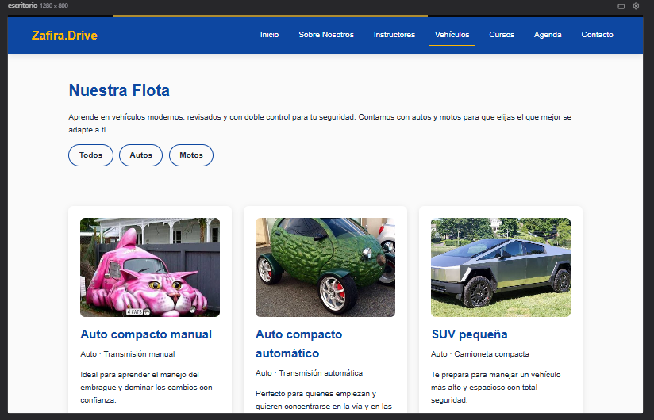
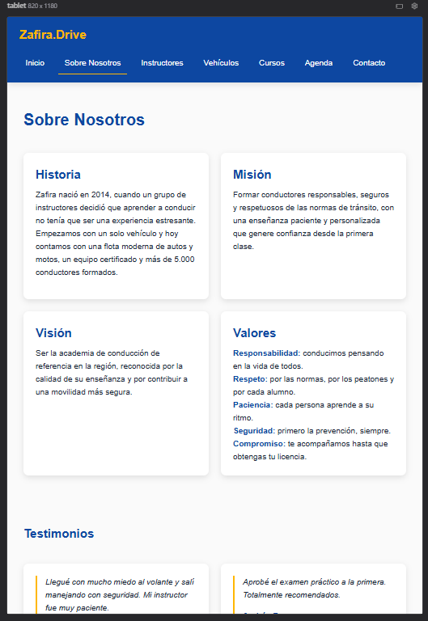

# Zafira Academia de Manejo

Sitio web informativo de una academia de conducción de autos y motos. Funciona como carta de presentación digital de la empresa: muestra sus cursos, instructores y vehículos, y permite solicitar una clase práctica.

Proyecto académico desarrollado solo con **HTML y CSS** (sin JavaScript).

- **Repositorio:** https://github.com/danfer009/zafira-drive
- **Autor:** Daniel Fernando Carreño Puentes

## Cómo visualizar el sitio

1. Descarga o clona el repositorio:
   ```
   git clone https://github.com/danfer009/zafira-drive.git
   ```
2. Abre la carpeta del proyecto.
3. Abre `index.html` en el navegador (doble clic), o usa la extensión **Live Server** de VS Code (clic derecho sobre `index.html` → *Open with Live Server*).

Necesitas conexión a internet para que cargue la fuente Poppins (Google Fonts) y el mapa de la página de contacto.

## Páginas del sitio

| Archivo | Contenido |
|---|---|
| `index.html` | Portada con hero animado, botón de acción y 4 tarjetas de servicios |
| `sobre.html` | Historia, misión, visión, valores y testimonios, con aparición progresiva |
| `instructores.html` | Tarjetas del equipo con foto, experiencia y licencia |
| `vehiculos.html` | Galería de autos y motos con filtros simulados |
| `cursos.html` | Tarjetas con precios y tabla comparativa |
| `agenda.html` | Formulario para solicitar una cita, con validación HTML5 |
| `contacto.html` | Datos de contacto en dos columnas y mapa incrustado |

El header con el menú y el footer con los íconos de redes sociales se repiten en todas las páginas.

## Estructura de carpetas

```
zafira-drive/
├── index.html
├── sobre.html
├── instructores.html
├── vehiculos.html
├── cursos.html
├── agenda.html
├── contacto.html
├── css/
│   ├── reset.css
│   ├── variables.css
│   ├── layout.css
│   └── styles.css
├── assets/
│   ├── img/
│   ├── icons/
│   └── capturas/
└── README.md
```

| Archivo CSS | Responsabilidad |
|---|---|
| `reset.css` | Quita los estilos por defecto del navegador |
| `variables.css` | Paleta, tipografía, espaciado, bordes y sombras |
| `layout.css` | Estructura general: header, menú, contenido y footer |
| `styles.css` | Componentes: botones, hero, tarjetas, tabla, formulario, contacto, animaciones y breakpoints |

## Decisiones de diseño

### Paleta de colores

| Variable | Color | Uso |
|---|---|---|
| `--primary` | `#0D47A1` | Azul principal: header, títulos y detalles. Transmite confianza y profesionalismo |
| `--secondary` | `#FFB703` | Dorado: botones y resaltes. Atrae la atención hacia las acciones |
| `--accent` | `#06D6A0` | Verde menta: acentos |
| `--text` | `#1F2937` | Gris oscuro: texto y footer, con buen contraste |
| `--bg` | `#FAFAFA` | Fondo general, claro y limpio |
| `--white` | `#FFFFFF` | Tarjetas y texto sobre fondos oscuros |

### Tipografía

Se usa **Poppins** (Google Fonts) en pesos 400, 600 y 700, con `sans-serif` como respaldo. Una sola familia en todo el sitio mantiene la coherencia visual.

### Medidas

- Espaciado base: `--space: 16px`, con múltiplos calculados mediante `calc()`.
- Bordes redondeados: `--radius: 10px`.
- Sombra suave: `0 4px 12px rgba(0, 0, 0, 0.1)`.

### Layout

- **Flexbox:** header, menú de navegación, footer, íconos de redes, filtros de vehículos, campos del formulario y las dos columnas de contacto.
- **CSS Grid:** grupos de tarjetas (servicios, instructores, vehículos, cursos) y el formulario.
- Contenido centrado con `max-width: 1100px`.

### Responsive

Tres breakpoints definidos con media queries:

| Pantalla | Rango | Comportamiento |
|---|---|---|
| Móvil | ≤ 600 px | Header en columna y tarjetas en 1 columna |
| Tablet | 601–992 px | Tarjetas en 2 columnas |
| Escritorio | ≥ 993 px | Tarjetas en 3 o 4 columnas |

La tabla comparativa se desliza horizontalmente en pantallas pequeñas.

### Animaciones y transiciones

- **`@keyframes` en el hero:** fondo con degradado en movimiento y texto que entra por partes.
- **`@keyframes` en el botón:** halo dorado pulsante en la portada.
- **`@keyframes` en las tarjetas:** entrada escalonada, que da la aparición progresiva.
- **Transiciones** en `:hover`, `:focus` y `:active` para enlaces, botones, tarjetas, filas de la tabla y campos del formulario.
- Se respeta `prefers-reduced-motion`: si la persona pidió menos movimiento en su sistema, las animaciones se desactivan.

### Accesibilidad

- Etiquetas semánticas: `header`, `nav`, `main`, `section`, `article`, `footer`.
- `lang="es"` en todas las páginas y un solo `h1` por página.
- Menú con `aria-label` y `aria-current="page"` en la página activa.
- Imágenes con `alt` descriptivo; íconos decorativos con `alt` vacío y enlaces con `aria-label`; `iframe` con `title`.
- Formulario con `label for`, `required` y validación de correo y teléfono.
- Tabla con `caption`, `thead`, `tbody` y `th` con `scope`; su contenedor desplazable recibe el foco con `tabindex="0"`.
- Estados `:focus-visible` y `:focus` visibles al navegar con teclado.

## Requisitos técnicos

| Requisito | Estado |
|---|---|
| Etiquetas semánticas | Hecho |
| Formularios con `label for` y `required` | Hecho |
| Imágenes con `alt` descriptivo | Hecho |
| Navegación con `aria-label` y `tabindex` | Hecho |
| Tabla con `thead`, `tbody`, `th`, `td` | Hecho |
| Archivo principal `css/styles.css` | Hecho |
| Variables CSS | Hecho |
| Layout con Grid y Flexbox | Hecho |
| Breakpoints (≤600px, 601–992px, ≥993px) | Hecho |
| Animaciones `@keyframes` (hero, botones, tarjetas) | Hecho |
| Transiciones `:hover`, `:focus`, `:active` | Hecho |
| Paleta y tipografía documentadas | Hecho |
| Modo oscuro con `prefers-color-scheme` (opcional) | No implementado |

## Capturas de pantalla

| Escritorio | Tablet | Móvil |
|---|---|---|
|  |  |  |

## Créditos de imágenes

Las fotografías provienen de sitios con licencia gratuita:

| Archivo | Autor | Fuente |
|---|---|---|
| `johan.jpg` | No identificado | Internet |
| `katherine.jpg` | No identificado | Internet |
| `luisa.jpg` | No identificado | Internet |
| `sebastian.jpg` | No identificado | Internet |
| `auto-manual.jpg` | No identificado | Internet |
| `automatico.jpg` | No identificado | Internet |
| `suv.jpg` | No identificado | Internet |
| `auto-doble-pedal.jpg` | No identificado | Internet |
| `moto125.jpg` | No identificado | Internet |
| `moto-150.jpg` | No identificado | Internet |

Las imágenes se optimizaron con [Squoosh](https://squoosh.app) (ancho de 800 px, MozJPEG, calidad 75).

Los íconos de redes sociales provienen de [Simple Icons](https://simpleicons.org) (licencia CC0).

## Notas

- Los datos de la academia (nombres, teléfonos, licencias, direcciones) son ficticios y con fines académicos.
- El botón "Solicitar cita" y los filtros de vehículos son simulaciones con enlaces `href`, porque el proyecto no usa JavaScript.